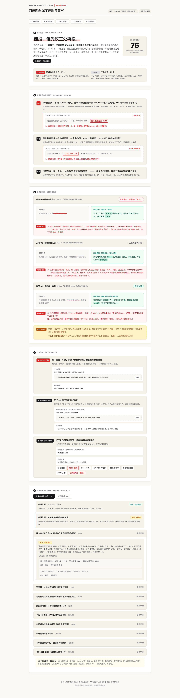
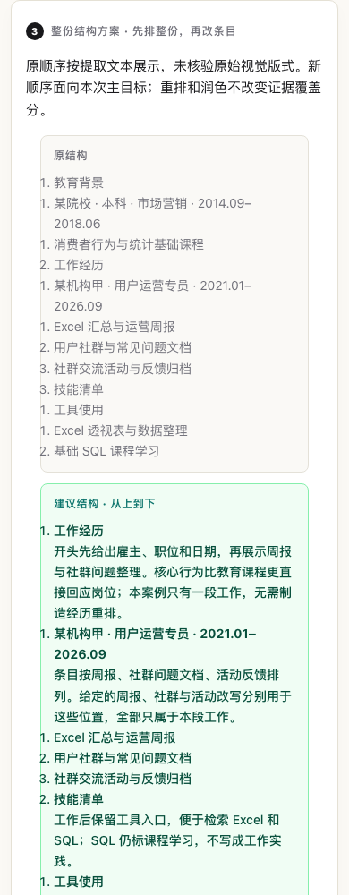
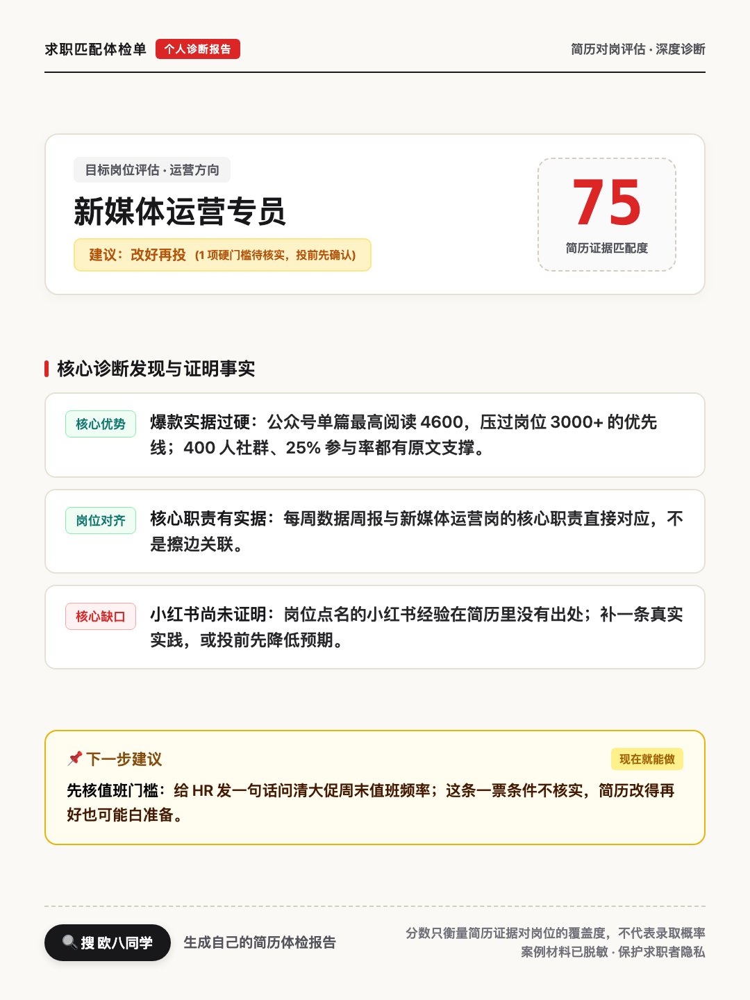
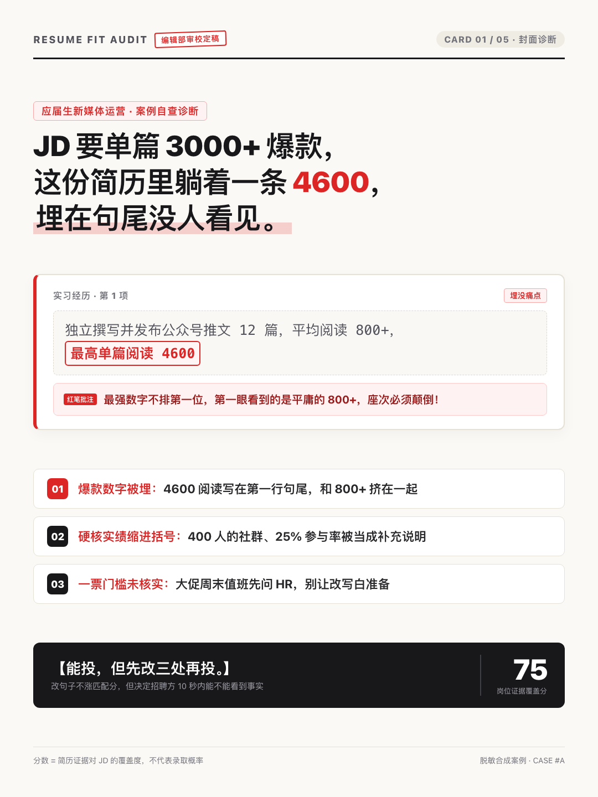
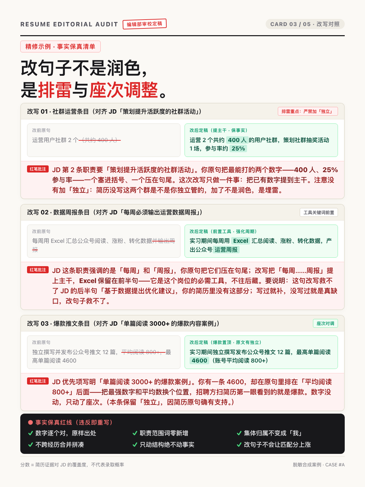

# AI简历优化大师（jd-resume-match）｜简历与 JD 匹配及证据审查

<!-- discovery:start -->
## Claude 简历优化与中文 JD 匹配

**怎么用 Claude 或 Codex 对照 JD 优化简历，又不编造经历？** 输入真实简历和岗位 JD，按原文行号核对证据、复算匹配分，输出结构调整、经历改写建议和岗位打招呼语。

Evidence-based resume optimization and job-description matching.

**第一次使用可以这样试**　用[合成简历和 JD](examples/README.md)试跑一次，挑一个被扣分的要求，对照报告列出的原文行号，再决定要补证据还是改写表述。

**一键安装 / MCP：** `uvx --from "git+https://github.com/ouxxyy/jd-resume-match#subdirectory=mcp" jd-resume-match-mcp` ｜ `npx skills add ouxxyy/ouba-classmate --skill jd-resume-match`

**开始使用：** [安装 Skill / MCP](#quick-start) · [看合成案例](examples/README.md)。

**使用边界：** 分数衡量规则下的证据覆盖，不是 ATS 官方评分或录用概率；不做视觉 PDF 排版，不凭空补数字。

[按任务浏览欧八同学的全部工具](https://github.com/ouxxyy/ouba-classmate#按需求找)；如果本项目有帮助，欢迎收藏当前仓库。
<!-- discovery:end -->

<!-- hero:start -->

<p>
  <a href="https://github.com/ouxxyy/ouba-classmate"></a>
</p>

**对照真实 JD 做确定性公式算分、原文行号（L1..Ln）证据锁定与去水分审计，附带本地 stdio MCP Server（仅做分数与证据审查，不做视觉 PDF 排版）。**  
<sub>Deterministic jd-match-rubric scorer, line-cited anti-hallucination resume audit (L1..Ln), and local stdio MCP server (score & evidence audit only; no visual PDF layout).</sub>

<p>
  <a href="https://github.com/ouxxyy/ouba-classmate"></a>
  <a href="#quick-example"></a>
  <a href="#quick-start"></a>
  <a href="#english-overview"></a>
  <a href="https://github.com/ouxxyy"></a>
</p>

> 🌟 本项目是 [欧八同学旗舰合集 `ouba-classmate`](https://github.com/ouxxyy/ouba-classmate) 的核心组件（11 个原创项目，可[一键安装全部 Skills](https://github.com/ouxxyy/ouba-classmate#install)）。如果它帮到了你，欢迎顺手给 [旗舰主仓库](https://github.com/ouxxyy/ouba-classmate) 点个 Star ⭐ 支持持续更新 ｜ 终端 1 秒加星：`gh api -X PUT /user/starred/ouxxyy/ouba-classmate`


<!-- hero:end -->

投简历之前，先看整份简历该怎么排，再看句子该怎么改，顺便生成能提高回复率的岗位打招呼语：按 JD 找证据、调整模块和经历顺序、深挖关键经历的价值，产出能力优先 / 成果优先 / 简洁自然三版话术，分数仍可复算，改写与话术均不编造事实。

Python 3.9+（仅标准库，零依赖）· 279 项自动化测试 · 内置 MCP Server（`uvx` 一键启动）· MIT

> [!TIP]
> 🎁 扫码关注公众号「欧八同学」，免费领取 AI 案例与 Skill《大厂产品AI经验编程 200 套》→ [去扫码](#author)

[使用示例](#quick-example) · [开始使用](#quick-start) · [English](#english-overview)

<a id="quick-example"></a>

## 一次使用示例

**输入示例：** 一份简历，以及要求“独立推进跨团队项目”的 JD。简历只写“参与项目”，没有说明自己的行动。

**输出：** 对该要求定位简历原文，标出支持程度和证据缺口；给出模块排序、经历深挖及改写建议。不会把“参与”直接改成“独立负责”，缺失数字会列为待补事实。

可先看 [合成案例与报告](examples/README.md)，再按 [安装说明](#quick-start) 使用。分数衡量证据覆盖，不是 ATS 官方评分。

## 它解决什么问题

改简历最怕两件事：看不出 JD 到底在筛什么，也说不清自己哪里够不上。

你把简历和一个或多个 JD 交给 AI 智能体（Claude Code / ZCode / Codex CLI 等支持 SKILL.md 的宿主），它会：

- 把每份 JD 拆成逐条要求，标出「必须 / 一般 / 加分」和一票条件（学历、年限、值班接受度这类硬门槛）；
- 在你的简历原文里逐条定位证据，给出 supported / partial / unclear / unmet / unknown 五态判定，每条都附原文引用和位置；
- 算出可复算的匹配分（0–100）与投递建议（优先投 / 改完再投 / 暂缓）——**unmet 硬门槛强制「暂缓」，高分抵消不了**；材料里没写的信息记 `unknown`，绝不推断成「不满足」；
- 盘点整份简历的模块、经历和条目，给出保留、前移、压缩或删除的依据。较早但相关的工作也可以前移，雇主、职位和日期仍保留；教育、项目和工作谁在前，由岗位要求和实际证据决定；
- 深挖关键经历的问题、本人角色、行动、产出和业务影响；缺结果或数字时列出该补什么、去哪里找，不把职责改成虚构的成绩；
- 给出有原文依据的招聘疑虑、面试追问和关键词诊断，区分同义表达、没写清与缺证据，按影响排列修改建议；
- 给出 3–5 处不改事实的重点改写（逐字前后对照，每个数字有出处，不新增「独立负责」这类原句没有的职责词）和 3 项行动清单；
- **生成高回复率岗位打招呼语（A. 能力优先 / B. 成果优先 / C. 简洁自然）**：遵循「最有价值的经历放前面、用 JD 决定突出哪段经历、短而高信息密度（不把整份简历复制进聊天框）」三大原则，HTML 报告支持一键复制；严格禁止编造经历/成果/数字/到岗时间，禁止用「学习能力强、吃苦耐劳」等空泛套话代替证据，匹配不足时明确指出边界不强行包装。

**分数只衡量「简历证据对 JD 要求的覆盖」，不是能力总分、ATS 官方分，也不是面试概率。**算分的不是模型：权重、系数、建议规则全部写在公开量尺 [`references/scoring-rubric.md`](references/scoring-rubric.md) 里，由确定性脚本复算，同一输入必得同一分数。

## 成品长什么样

编辑批注风的 HTML 体检单（自包含单文件，`file://` 直接打开，不联网）：

<p align="center">
  
</p>
<p align="center"><sub>报告整页缩略（v0.3.0 合成运营案例）· 阅读顺序：投递判断与分数 → 优势和关键差距 → 整份结构方案 → 重点改写 → 待补事实及行动 → 原文依据</sub></p>

<p align="center">
  
</p>
<p align="center"><sub>整份结构方案直接展开；经历价值链、招聘疑虑和关键词依据可展开查看。样式沿用原报告。</sub></p>

合成样例：[较早相关工作前移](examples/strategy-upgrade/older-relevant-work/preview/report.html) · [应届生投数据岗](examples/strategy-upgrade/freshgrad-project/preview/report.html) · [同一人改投研究岗](examples/strategy-upgrade/freshgrad-project-research/preview/report.html)。

交付物还有两套 1080×1440 分享卡与发布文案（以下来自不同合成案例，均已脱敏）：

<table>
  <tr>
    <td align="center"><br><sub>成员版分享卡（默认 1 张，给求职者本人）</sub></td>
    <td align="center"><br><sub>案例版卡片 · 封面</sub></td>
    <td align="center"><br><sub>案例版卡片 · 改写对照</sub></td>
  </tr>
</table>

案例版卡片（1–6 张）与配套小红书文案面向做求职内容分享的创作者，文案里每条标题都有报告证据对应。

## 怎么工作

六步，模型与脚本各管一段，分数永远出自脚本：

1. **提交材料**：一份简历（PDF / DOCX / TXT / MD）+ 一个或多个 JD（文本、文件或链接）。
2. **脚本提取**：解析文件并给识别摘要；空文件、加密、扫描件、乱码 PDF 走显式降级路径，说清楚缺什么、怎么补，不硬装能分析。
3. **模型初诊**：拆 JD 要求、盘点全篇并决定模块/经历/条目顺序，生成 3 个可比较的岗位打招呼语版本（能力优先/成果优先/简洁自然）及重点改写（此步不算分）；最多 3 个澄清问题，可整体跳过，你的回答只作为补充证据登记。
4. **脚本算分**：`score_report.py` 按量尺复算分数 / 建议 / 排名并回写；结构、引用、隐私、套话黑名单与防编造校验任何一项不过，直接拒绝出报告。
5. **渲染交付**：自包含 HTML 体检单 + 成员版分享卡 PNG + 案例版卡片与发布文案。
6. **三句话结论**：怎么投、最值钱也最委屈的发现（带数字）、现在就能做的第一步。

<a id="quick-start"></a>

## 安装

需要 Python 3.9+（仅标准库，无需 `pip install`）和一个支持 `SKILL.md` 的智能体宿主；导出 PNG 需要本机装有 Chrome / Chromium / Edge（不装也能拿到全部 HTML / MD 成品）。

```bash
# ZCode 等宿主
git clone https://github.com/ouxxyy/jd-resume-match.git ~/.zcode/skills/jd-resume-match

# Codex（共享 Skills 目录）
git clone https://github.com/ouxxyy/jd-resume-match.git ~/.agents/skills/jd-resume-match

# Claude Code
git clone https://github.com/ouxxyy/jd-resume-match.git ~/.claude/skills/jd-resume-match
```

仓库根目录就是 skill 本体，clone 即可用。想装得干净（不带 tests / docs），从 [Releases](https://github.com/ouxxyy/jd-resume-match/releases) 下载 zip（附 sha256 校验值）后按包内 INSTALL.md 安装；仓库根的 `./install.sh <你的 skills 目录>` 也支持完整源码安装。全部安装路径见 [INSTALL.md](INSTALL.md)。

### 方式二：作为 MCP Server 一键接入（Claude Desktop / Claude Code / Cursor / Codex）

本仓库提供零依赖、纯本地运行的 MCP Server（见 [`mcp/`](mcp/) 与 [`server.json`](server.json)，命名空间 `io.github.ouxxyy/jd-resume-match`），只暴露 `match_resume(jd, resume)` 工具，返回按 `jd-match-rubric/0.1.0` 公式复算的分数、逐条 JD 要求的简历原文行号证据引用（`L1..Ln`）、缺口清单与 A/B/C 三版本岗位打招呼语草稿：

```json
{
  "mcpServers": {
    "jd-resume-match": {
      "command": "uvx",
      "args": [
        "--from",
        "git+https://github.com/ouxxyy/jd-resume-match#subdirectory=mcp",
        "jd-resume-match-mcp"
      ]
    }
  }
}
```

## 第一次使用

对智能体说：

> 用 jd-resume-match 分析我的简历 + 这个 JD

把简历文件和 JD（文本 / 文件 / 链接）发给它即可。想先看效果，直接用自带的合成案例：

> 用 jd-resume-match 体检 examples/case-a-freshgrad-ops/ 里的合成简历

不依赖智能体也能验证脚本体（装完的冒烟检查）：

```bash
python3 ~/.zcode/skills/jd-resume-match/scripts/validate_report.py \
  --input ~/.zcode/skills/jd-resume-match/examples/case-b-2yr-data-dev/expected.json
# 期望输出包含 PASS（结构 + 引用 + 隐私校验通过）
```

## 校验与开发

```bash
# 全量测试（契约校验、评分规则、提取降级、渲染/分享、编排纪律、脱敏隔离）
python3 -m unittest discover -s tests -v

# 复算黄金案例的分数并与期望值核对 / 逐项推导
python3 scripts/reference_score.py --check examples/case-a-freshgrad-ops/expected.json
python3 scripts/reference_score.py --show  examples/case-a-freshgrad-ops/expected.json

# 重新生成发布素材（确定性渲染，同输入同输出）
python3 scripts/render_editorial.py --input examples/<案例>/expected.json \
  --editorial examples/<案例>/editorial.json --outdir dist/publish/<案例>
```

评分口径（权重 / 系数 / 建议规则）只住在 `references/scoring-rubric.md`；改它必须升版本号并同步更新全部黄金案例期望值，同一提交内完成——测试会守住这条线。

## 隐私

- 真实材料只在本地会话中处理；本 skill 不询问、不存储任何 API 密钥。「离线」指报告浏览不需联网，分析过程由宿主智能体及其配置的模型完成。
- 分享卡与发布文案只消费脱敏白名单字段，生成前过 `private_markers` / 邮箱 / 手机号扫描；真实案例须先在数据源完成公司、学校等泛化并登记 `redactions` 白名单。**完整报告含材料细节，发布前自己预览，不要外发。**
- 仓库内 `examples/` 全部是合成材料（`synthetic: true`），无一真实简历或 JD。

## 限制（诚实清单）

- **中文 PDF 大概率乱码**：CID / Type0 字体不做解码（零依赖的边界），会明确告警并请你改贴文本或用 DOCX / TXT；「乱码必有告警」由双防线保证，但告警不等于能读。不做 OCR，扫描件直接拒绝评分，绝不拿 0 字节硬算分。
- JD 链接抓取尽力而为（10 秒超时、2MB 上限）；需登录或反爬的页面会失败，引导你粘贴全文。
- 初诊、澄清与证据引用的质量依赖宿主智能体；提取、校验、评分、渲染是确定性脚本，同输入必出同输出。
- 分数基于 4 个合成案例、7 个岗位视角校准（rubric 0.1.0），衡量证据覆盖度，不预测任何录取概率，也不宣称「XX% 置信度」。

## 常见问题

### 匹配分可以当作录用概率吗？

不能。它衡量简历证据对 JD 要求的覆盖程度，不是能力总分、ATS 官方分或录用概率。

### 可以同时对比多个 JD 吗？

可以。每个 JD 单独拆要求、引用证据和计算分数，硬门槛不会被高分抵消。

### 会帮我补成绩或改掉工作时间吗？

不会。结构与措辞建议保留雇主、职位、日期和事实，缺少的结果或数字会列入待补材料。

### PDF 和离线能力有什么限制？

不做 OCR，中文 PDF 提取可能乱码；可换成 DOCX/TXT/MD。离线的是 HTML 报告，分析仍由你的宿主模型完成。

<a id="english-overview"></a>

## English overview

An evidence-based resume and job-description matching Skill with reproducible scoring, resume structure advice and an offline HTML report. It traces judgments to your original text and flags missing evidence instead of inventing achievements.

See [installation](#quick-start) and [synthetic examples](examples/README.md). Python 3.9+ is required. Scores measure evidence coverage, not ATS scores or hiring probability. Scanned PDFs are not OCR-processed; analysis uses your agent's model even though the resulting report can be read offline.

<!-- suite-matrix:start -->

## 更多开源项目 · More from ouba-classmate Suite

> 如果这个项目帮到了你，欢迎去旗舰合集仓 [**`ouxxyy/ouba-classmate`**](https://github.com/ouxxyy/ouba-classmate) 点一颗 Star 或一行安装全部 Skills：
> `npx skills add ouxxyy/ouba-classmate` · `gh api -X PUT /user/starred/ouxxyy/ouba-classmate`

| 仓库 · Repo | 分类 · Category | 它做什么 · What it does |
| --- | --- | --- |
| [`ouba-classmate`](https://github.com/ouxxyy/ouba-classmate) | SUITE · 旗舰合集 | **11 个原创项目总仓 + 一键安装全部 Skills + 在线战力测算与防身情报库**<br><sub>All-in-one Skills suite & benchmark</sub> |
| [`jd-resume-match`](https://github.com/ouxxyy/jd-resume-match) · **Current** | CAREER · 求职涨薪 | **AI 简历优化与 JD 匹配体检（确定性公式 + 行号证据）**<br><sub>Deterministic JD matching & line-cited resume audit</sub> |
| [`ai-interviewer`](https://github.com/ouxxyy/ai-interviewer) | CAREER · 求职涨薪 | **中文语音/文字原话追问 AI 模拟面试官（含在线版）**<br><sub>Chinese voice AI mock interviewer anchored to your answers</sub> |
| [`job-search`](https://github.com/ouxxyy/job-search) | CAREER · 求职涨薪 | **跨 5 平台实时去重筛岗，输出带来源短名单**<br><sub>5-platform source-backed job search & shortlist builder</sub> |
| [`sherlock-company`](https://github.com/ouxxyy/sherlock-company) | CAREER · 求职涨薪 | **入职前四态证据公司背调与 Offer 核实清单**<br><sub>Pre-offer employer research with 4-state evidence boundaries</sub> |
| [`mbai`](https://github.com/ouxxyy/mbai) | CAREER · 求职涨薪 | **工作任务 AI 不可替代指数与 4 核决策复盘**<br><sub>Task-level AI irreplaceability index & decision reflection</sub> |
| [`codex-gif-video`](https://github.com/ouxxyy/codex-gif-video) | CREATIVE · AI 创作 | **69 种风格原生 GIF 与静音 MP4 素材生成 Skill**<br><sub>Native GPT Image 2.6 animated GIF & MP4 generator (69 styles)</sub> |
| [`storyboard-scavenger`](https://github.com/ouxxyy/storyboard-scavenger) | CREATIVE · AI 创作 | **可灵/即梦/Veo/Sora 七要素 AI 视频分镜工作流**<br><sub>7-element AI video storyboard skill for Kling & Seedance</sub> |
| [`travel-art-album-skill`](https://github.com/ouxxyy/travel-art-album-skill) | CREATIVE · AI 创作 | **旅行照片艺术画册与单文件离线翻页相册 Skill**<br><sub>Art-styled travel photo proofs & standalone offline HTML flipbook</sub> |
| [`mystery-skill`](https://github.com/ouxxyy/mystery-skill) | COGNITION · 认知框架 | **Mystery 认知框架与职场心理博弈分析 Skill**<br><sub>Cognitive framework for interview frame & decision study</sub> |
| [`Attention`](https://github.com/ouxxyy/Attention) | LOCAL APP · 本地工具 | **ActivityWatch 本地专注力、心流时段与切换分析**<br><sub>Local ActivityWatch focus & context-switching dashboard</sub> |
| [`postapp`](https://github.com/ouxxyy/postapp) | LOCAL APP · 本地工具 | **Chrome 本地摄像头姿态检测与坐姿提醒插件**<br><sub>On-device MoveNet Chrome posture reminder extension</sub> |

<!-- suite-matrix:end -->

<a id="author"></a>

## 作者

作者全平台同名：**欧八同学**。

- 个人主页 / 联系我：[albertou.redboook.cn](https://albertou.redboook.cn/)
- 微信公众号：扫码关注，免费领取 AI 案例与 Skill《大厂产品AI经验编程 200 套》
- 抖音：[搜索“欧八同学”](https://www.douyin.com/search/%E6%AC%A7%E5%85%AB%E5%90%8C%E5%AD%A6)
- 小红书：[搜索“欧八同学”](https://www.xiaohongshu.com/search_result?keyword=%E6%AC%A7%E5%85%AB%E5%90%8C%E5%AD%A6)
- X：[搜索“欧八同学”](https://x.com/search?q=%E6%AC%A7%E5%85%AB%E5%90%8C%E5%AD%A6&src=typed_query)

<p align="center">
  
</p>

<p align="center"><sub>扫码关注「欧八同学」，免费领取《大厂产品AI经验编程 200 套》</sub></p>

如果这个项目对你有用，欢迎点个 Star。遇到问题时，提交命令、报错和最小复现步骤就够了；请不要上传真实私人照片。

## 许可证

[MIT](LICENSE)。本项目未复制任何上游仓库代码；研究过的仓库与许可证边界见 [THIRD_PARTY_NOTICES.md](THIRD_PARTY_NOTICES.md) 和 [docs/reference-audit.md](docs/reference-audit.md)。

<!-- footer:start -->

<p align="center">
  <a href="https://github.com/ouxxyy"></a>
</p>

<!-- footer:end -->
